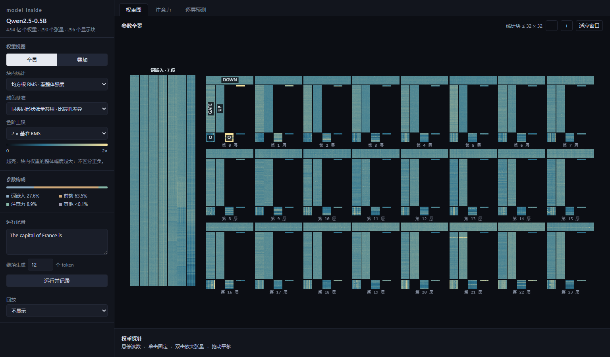

# model-inside

**v1.0.0 正式版** · 包含权重图、注意力、逐层预测和无滚动条回放布局。源码发布包不含模型权重和本机录制；请使用自己的模型路径启动。

把本地 safetensors 模型画成可缩放的权重图。图的面积表示参数量，颜色表示所选的**权重统计量**，不是对某个答案的重要性。



## 运行

```bash
python -m pip install -r requirements.txt
python -m model_inside models/Qwen2.5-0.5B
```

打开 <http://127.0.0.1:8000/>。也可以传入其他模型目录或单个 `.safetensors` 文件；权重查看器按需读取文件，不需要先运行推理。服务已启动时，修改 Python 后需要重启。旧录制可以继续使用，新版瓦片缓存与旧版分开。

## 从全景到一个权重

- **看结构：**层外的大张量可能切段并排显示；显示块数不等于原始张量数。参数构成按原始张量名归类，未识别的归入「其他」。黑色间隙是布局留白。
- **比层间强弱：**默认用块内均方根（RMS）表示幅度，数值越大颜色越亮。同角色、同形状的层共用一个采样 RMS 基准，没有同类时使用本张量的基准。色阶上限以该基准的倍数计，不同角色的颜色不直接比较。切分的同一张量始终共用色标。
- **看纹理或离群值：**选择独立色标强调张量内部差异；选择「块内绝对值最大的权重」找极值，蓝负暖正。均值模式也保留符号，但正负会抵消。RMS 模式在单权重处显示绝对值，探针仍报告有符号的原始权重。
- **读一个数：**悬停查看当前统计块覆盖的行列（从 0 开始，包含两端）、RMS、均值和带符号极值。多维张量的列坐标为展平列；单权重处显示原始多维下标。滚轮缩放、拖动平移，双击适应一个张量。单击或轻触固定探针；可分组的张量提供「对照同类层」，保留选中层。按 Esc 或再次点选解除固定。
- **了解一次生成：**选择或新建录制，再查看绿色贡献叠加、注意力和逐层预测。绿色是局部线性项 `|w·x|` 超过阈值的标记，缩小时按采样估计；不能据此直接断定某个权重对答案有因果作用。

逐层预测和注意力图按工作区大小排版。预测表底部可按层或位置翻页，回放会跟随当前 token；窄屏或矮窗口可用页内按钮切换预测表、排名、候选词，或切换注意力连线、矩阵和各头一览，无需拖动滚动条。

## 验证

```bash
python -m pytest -q
# 对运行中的服务做瓦片、录制回放等检查（不加 --record 不生成新录制）
python scripts/smoke_test.py http://127.0.0.1:8000
# 可选：已安装 Node playwright 和 Chromium 时，跑桌面与窄屏交互检查
node scripts/check_atlas.cjs http://127.0.0.1:8000
# 多尺寸回放布局、翻页与点击命中（需要一条带注意力和逐层预测的录制）
node scripts/check_replay_layout.cjs http://127.0.0.1:8000
```

浏览器检查可加第二个参数指定截图目录。`model_inside/tiles.py` 负责聚合和块读数，`model_inside/store.py` 负责张量映射及色标，`model_inside/static/` 中的画布负责显示与命中测试。
